# Lua 思维可视化 · Lua Mindscape（UX 概念原型 v0）

> 让 Lua 的求值过程「看得见」：执行光标沿着语法树移动，走过的路径被点亮，
> 节点上浮现求值结果，递归栈帧按嵌套深度分层着色——像看到程序在思考。

**English (for awesome-lua / community listings):**

> - **[Lua Mindscape](https://github.com/ONGIKAN/lua-mindscape)** - An interactive visual debugger that projects Lua's evaluation trace onto the AST in real time, making recursion, scope frames and table aliases visible (single-page web prototype; Rust + WebAssembly core planned).

> 中文：本 README。English: [README.en.md](README.en.md)。设计细节：[docs/DESIGN.md](docs/DESIGN.md)（[English](docs/DESIGN.en.md)）。

**在线演示 / Live demo:** <https://ongikan.github.io/lua-mindscape/> · **GitHub:** <https://github.com/ONGIKAN/lua-mindscape>

---

## 这是什么

这是一个**单文件、零依赖的前端原型**，用来验证一个产品想法：

> 一个 Lua 运行时，可以实时显示 AST，并且把「执行 / 求值」这件事可视化出来，让人像看大脑思考一样看程序运行。

纯静态页面，双击 `index.html` 即可运行（file:// 也可以，不需要构建、不需要联网）。
现在还支持**直接编辑代码并运行**、**新建 / 导入（含拖拽）Lua 文件**、**中英双语界面**、**安装为桌面 / 手机客户端（PWA，离线可用）**；
语法树使用「整树自适应 + 死区跟随」相机：加载 / 运行后自动把整棵树缩放并居中放进树面板，
播放时只要当前节点还在视口内，画面就完全不动；只有节点要移出视口时才一次性平移过去。
树图有 **规整 ▦ / 神经元 ◉ 两种布局**，树面板右上角一键切换，选择会被记住。

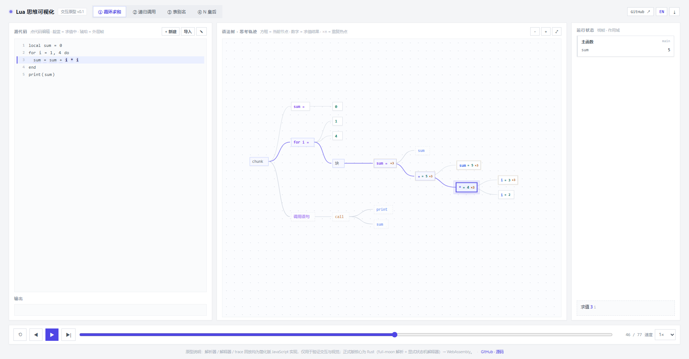

## 核心设计：AST 只是骨架，真正像「思考」的是求值轨迹

只把 AST 画出来是非常静态的（很多 IDE 都能做到）。这个原型把三件事叠在一起：

1. **结构**：语法树（按运算优先级自动成树）；
2. **轨迹**：解释器输出的显式事件流 `ent / cls / val / set / call / ret / iter / print / end / error`，
   时间轴回放，每个事件对应树上的一个节点；
3. **状态**：当前节点、调用栈帧、变量绑定、已求值节点、迭代热点（×n）。

视觉映射：

| 视觉 | 含义 |
| --- | --- |
| 圆环 + 放大 | 当前正在求值 / 执行的节点 |
| 靛蓝实线 | 从根到当前节点的「思路路径」 |
| 节点后的 `= 值` | 该表达式已经算出的结果 |
| 代码行高亮 | 当前节点、外层栈帧对应的源码 |
| 栈帧卡片 + 颜色 | 每个栈帧一种颜色，节点光晕与所在栈帧同色 |
| `×n` | 同一节点被重复执行（循环 / 递归）的次数 |
| 表对象彩色圆点 | 引用同一个表的变量显示同一个颜色点（一眼看出别名） |

| 递归：4 个栈帧、n = 3/2/1 | 表别名：`a` 和 `b` 指向同一张表 `t1` |
| --- | --- |
| 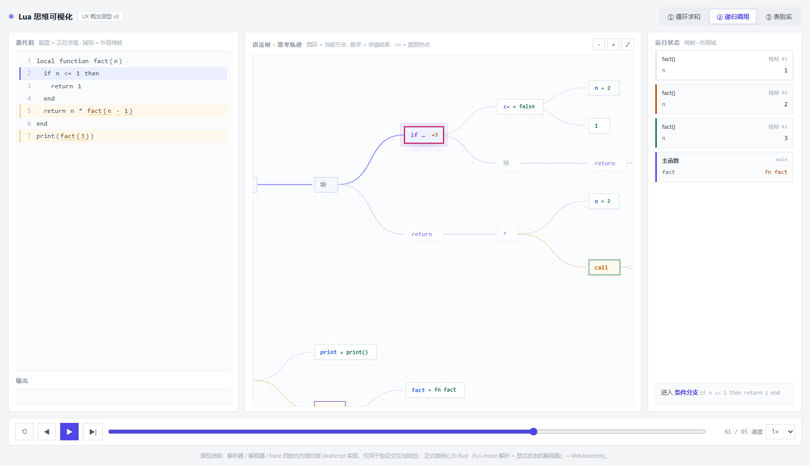 | 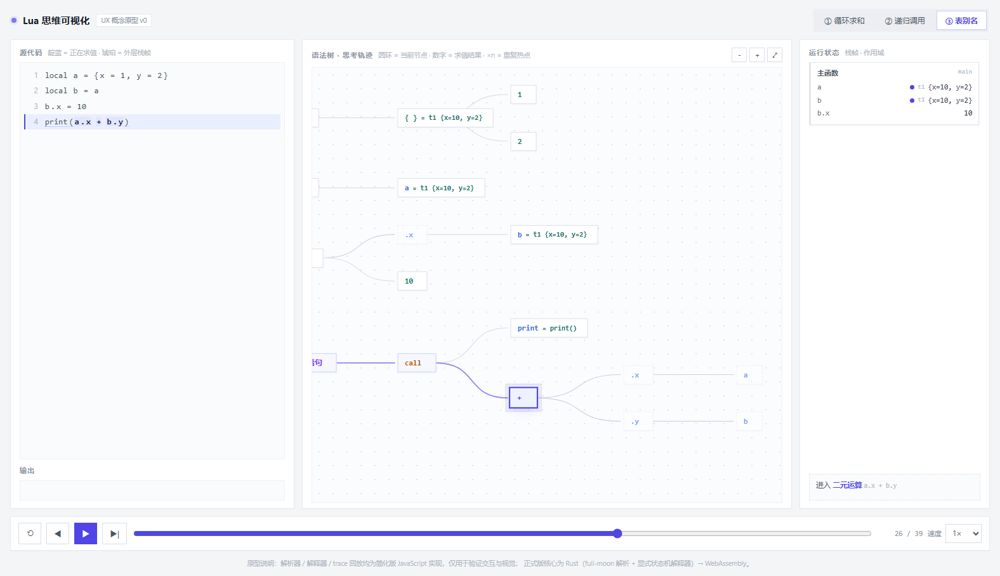 |

## 支持的语言子集

原型不是完整的 Lua 5.4，但已经覆盖到能跑真实算法代码（内置的 ④ N 皇后 就是一段现成可运行的位运算回溯）：

- **语句**：`local`、赋值（含多目标）、`if / elseif / else`、`while`、`do … end`、数值 `for`、
  `return`、函数定义（`function` / `local function`）、调用语句、分号；
- **表达式**：算术 `+ - * / // % ^`、比较、`and / or / not`、字符串拼接 `..`、一元 `-` `#` `~`、
  位运算 `& | ~ << >>`（Lua 5.3+ 语义）、括号、表构造 / 字段访问 / **下标 `t[k]`**；
- **标准库**：`print`、`tonumber`、`tostring`、`type`、`assert`、`error`、`math.*`、`string.*`、
  `table.insert` / `table.concat`，以及全局 `arg`（原型里 `arg[1] = '6'`，所以 N 皇后跑 6 皇后）；
- 解析错误会给出「第几行第几列 + 附近源码」，并在代码区就地显示。

暂不支持（正式版 Rust 解释器会逐步补齐）：`repeat/until`、泛型 `for … in`、元表与 `:` 方法语法糖、
`goto`、`coroutine`、可变参数 `...`、多返回值、`require` 等。

## 快速开始

```bash
# 方式一：直接打开
#   双击 index.html（file:// 即可运行）

# 方式二：本地静态服务器（推荐，行为最接近线上；PWA 安装与离线也需要 http/https）
python -m http.server 8080
# 浏览器打开 http://127.0.0.1:8080
```

### 作为客户端安装（PWA，适合平板 / 手机）

通过 http(s) 打开后：

- **桌面 Chrome / Edge**：地址栏右侧安装图标，或页面右上角 `⤓` 按钮 → 安装；
- **Android Chrome**：菜单 → 「安装应用」/「添加到主屏幕」；
- **iOS Safari**：分享 → 「添加到主屏幕」。

安装后离线可用（Service Worker 缓存应用外壳），窗口独立、无浏览器地址栏。
正式版桌面 / 移动端会改为 **Tauri 2** 打包原生安装包（详见「正式版架构」）。

### 操作

| 操作 | 说明 |
| --- | --- |
| `空格` | 播放 / 暂停 |
| `←` / `→` | 上一步 / 下一步 |
| `R` | 回到开头 |
| 点击语法树节点 | 跳到「执行到该节点」的时刻 |
| 时间轴滑块 | 任意拖动回放（可直接看某一刻的状态） |
| 树区域拖动 / 缩放按钮 | 平移、缩放；`⤢` 恢复「跟随当前节点」 |
| 树面板右上 `▦ 规整 / ◉ 神经元` | 切换树布局（记住选择；也可用 `?layout=` 指定） |
| 点击左侧代码 / 工具栏 `✎` | 进入编辑模式，直接改 Lua 代码 |
| 工具栏 `+ 新建` / `导入` | 新建程序 / 导入 `.lua` 文件；也可以把文件直接拖进代码区（导入后自动运行） |
| `Ctrl`/`⌘` + `Enter` | 运行编辑中的代码；解析错误会就地提示 |
| `Esc` | 取消编辑，回到运行中的代码 |
| 右上角 `EN / 中` | 切换中英文界面 |

四个内置示例：循环求和、递归调用、表别名、**N 皇后（位运算回溯）**。输出分别为 **30 / 6 / 12 / 4**。
其中 N 皇后是一段可以直接运行的「真实算法代码」（递归 + 位运算 + 下标 + 标准库），
只用一条指令 `print(count)` 收尾；它同时演示了递归栈帧、重复热点和位运算表达式的树结构。

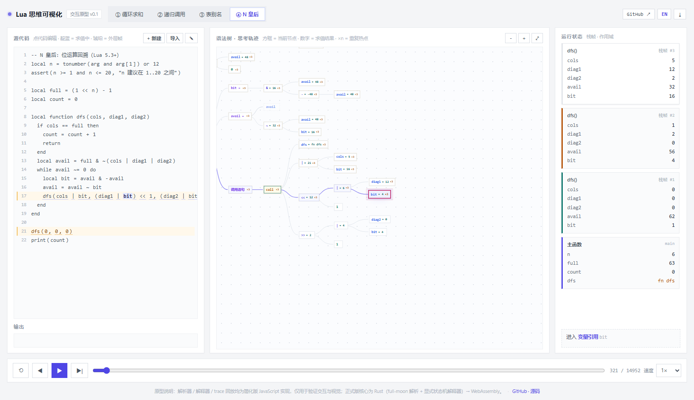

相机是「整树自适应 + 死区跟随」：加载 / 运行后先把整棵树缩放到刚好放进树面板并居中；
播放时当前节点在视口内就绝不移动画面，只有节点快要移出视口时才一次性移到中间。
点击某个节点、或点 `⤢` / 缩放按钮时会主动居中。这样播放时视线不会跟着每个事件来回甩。

### 两种树布局

| 规整 ▦ | 神经元 ◉ |
| --- | --- |
| 经典 tidy tree，层级清晰，适合读语法结构 | 节点径向散开 + 弯曲流动边，更像神经网络在活动 |
| 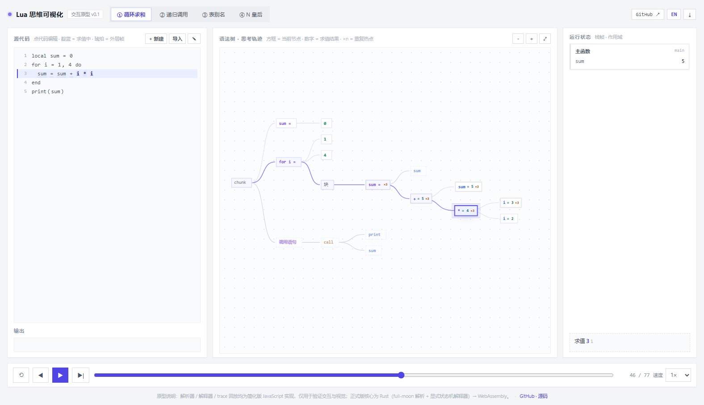 | 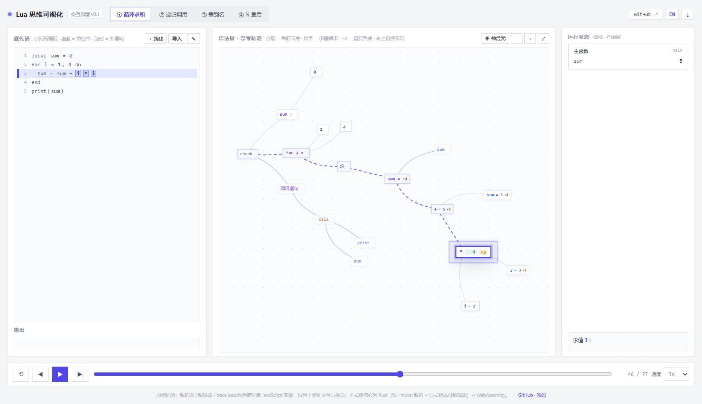
N 皇后（150 个 AST 节点）在神经元布局下的样子：

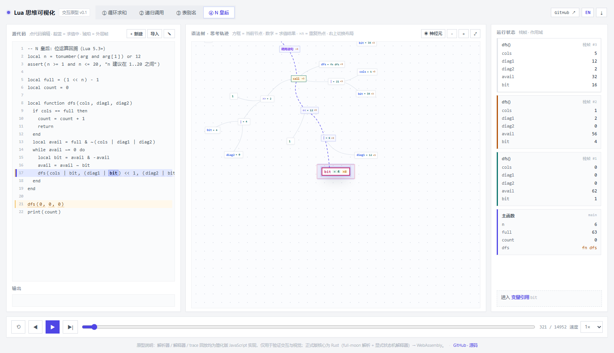 |

当前节点做了强高亮：放大、描边加粗、外圈脉冲光晕，`= 值` 与 `×n` 变成胶囊标签，
无论在哪种布局、桌面还是手机上，都能一眼找到「此刻在算哪里」。

### URL 参数（方便做截图与 UI 自动化）

| 参数 | 作用 |
| --- | --- |
| `program=loop\|fact\|alias\|queens` | 选择示例程序 |
| `still=1&step=N` | 静态渲染到第 N 个事件（不自动播放，方便截图） |
| `speed=N` | 事件间隔毫秒数（默认 180） |
| `scale=0.72` | 初始缩放比例 |
| `debug=1` | 把相机/布局状态写进 `document.title`（调试用） |
| `lang=zh\|en` | 界面语言（默认跟随上次选择，存在 localStorage） |
| `layout=grid\|neuron` | 初始树布局（默认跟随上次选择） |

编辑过的代码会保存在浏览器 localStorage（`lua-mindscape:src`），重新打开自动恢复；
带 `?program=` 时以示例程序为准。`↺ 示例` 可随时恢复内置代码。

## 目录

```
lua-brain-proto/
├── index.html              单页应用（三栏布局，内嵌代码编辑器）
├── style.css               浅色方形简约主题 + 响应式（≤980px 单列堆叠）
├── app.js                  简化 Lua 子集解析器 + 显式状态机解释器 + trace 回放 + 编辑器 + i18n
├── manifest.webmanifest    PWA 应用清单（可安装为桌面/移动客户端）
├── sw.js                   Service Worker（应用外壳缓存，离线可用）
├── icons/                  PWA / 桌面图标
├── tools/
│   ├── inspect-trace.js    Node CLI：打印事件流与每步状态（调试解释器）
│   └── qa.mjs              无头 Edge + CDP：截图 / 断言 / 响应式验收（零依赖）
├── docs/
│   ├── DESIGN.md           设计文档（中文）
│   ├── DESIGN.en.md        设计文档（English）
│   ├── images/             截图（桌面 / 规整布局 / 神经元布局 / 递归 / 别名 / N 皇后 / 编辑器 / 平板 / 手机 / 英文界面）
│   └── community-submission.md   Lua 社区提交材料草稿（awesome-lua / lua-users / lua-l / Reddit）
├── README.md               中文文档（本页）
└── README.en.md            English documentation
```

## 原型验证结果（QA）

用 `tools/qa.mjs`（Edge headless + Chrome DevTools Protocol）在真实浏览器里验收：

- 四个示例程序语义正确：loop → `30`、fact → `6`、alias → `12`、queens → `4`（事件数 77 / 85 / 39 / 14,952）；
- 递归时 4 个栈帧同时存在，`n` 分别为 3 / 2 / 1，颜色与节点光晕一致；
- 表别名：`a` 与 `b` 显示同一个 `t1` 颜色点，`b.x = 10` 后 `a.x` 同步为 10；
- N 皇后（真实位运算回溯代码，含 `arg` / `tonumber` / `assert` / 下标 / `& | ~ << >>`）解析执行正确，
  递归 3 层栈帧同时可见（`cols / diag1 / diag2 / avail / bit` 各帧值），输出 `4`；
- 桌面 1600×1000 / 1920×1080、平板 820×1180、手机 390×844 布局均可用；
- 页面无异常、无 console error；时间轴拖动、单步、点击节点跳转、切示例程序均验证通过；
- 代码编辑：自定义代码 `local x = 5 / print(x * 2)` 运行成功（19 个 trace 事件），解析错误就地显示；
  把整段 N 皇后代码粘进编辑器也能直接运行；
- 新建 / 导入：新建模板可直接运行；`importText()` 与拖拽导入均自动编译并运行（如 `local a = 2 / print(a*a)` 输出 `4`）；
- 相机稳定性：1666px 宽度下整树自动适配为 0.94 倍并完整可见；在 77 个连续事件里相机位置变化 **0 次**（上一版 31 步内 6 次平移）。树尺寸从 1201×675 压缩到 **802×394**（loop 示例，约 -33%）；
- 两种树布局均通过：规整 `▦`、神经元 `◉` 均 0 异常；神经元模式经节点斥力松弛后相邻节点不再重叠，英文按钮为 `◉ Neuron`，手机 390×844 正常缩放，选择写入 localStorage 后刷新保持，`?layout=neuron` 可直接进入；
- 强高亮：当前节点放大 + 加粗描边 + 外圈光晕 + 数值胶囊，规整 / 神经元、桌面 / 手机均生效；
- 手机端（≤520px）紧凑布局：顶部只留品牌 + GitHub 图标 + 语言按钮，示例标签单行横向滚动；
  代码工具栏收成 `＋ / ⇩ / ✎` 图标、代码区可见约 5 行；状态栏压成一行栈帧胶囊（变量内联）+
  单行步骤说明；树面板按屏幕自适应缩放整树，支持双指捏合缩放与拖动平移；页脚隐藏；
  390×844 / 430×932 实测无裁切、0 异常；
- 中英双语：`?lang=en` 下标题 / 品牌 / 提示 / 栈帧文案全部切换，`EN / 中` 按钮可即时切换并记住选择；
- PWA：manifest 与 Service Worker 注册成功，可安装、离线打开。

| 平板 | 手机 |
| --- | --- |
| 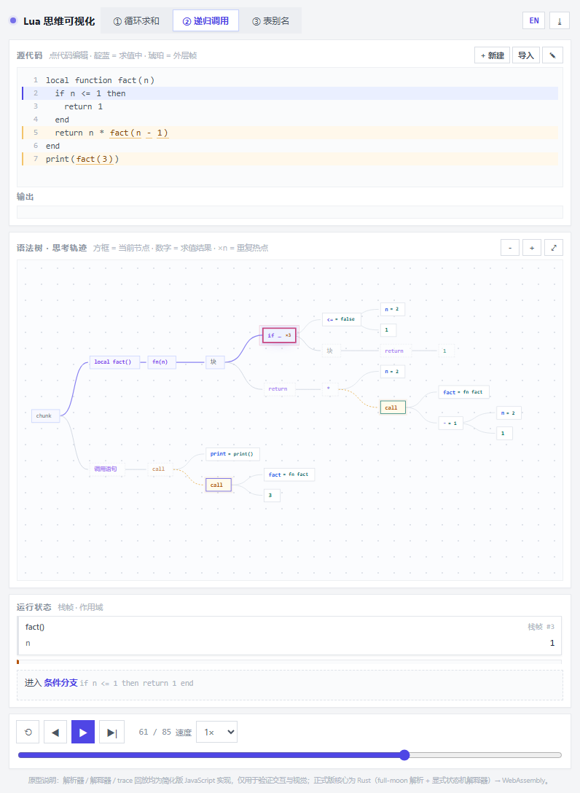 | 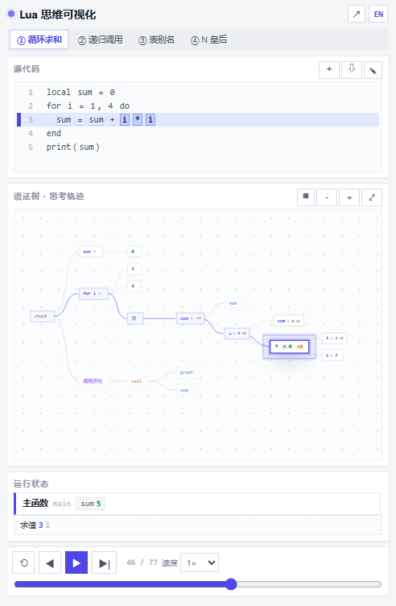 |

| 直接编辑代码并运行 | 英文界面 |
| --- | --- |
| 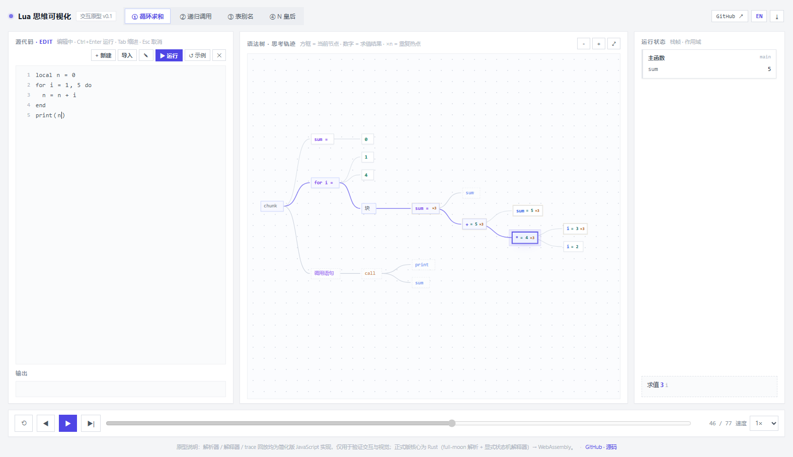 | 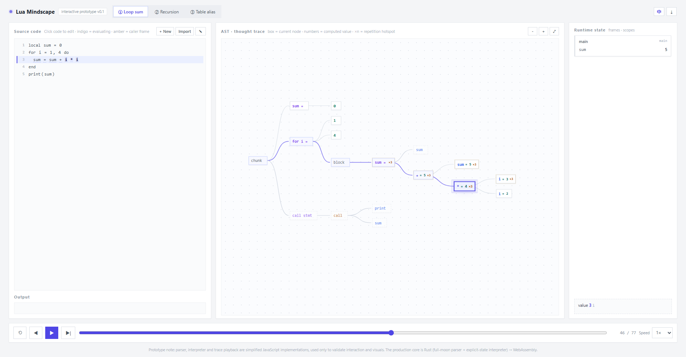 |

### 重新生成截图

```bash
node tools/qa.mjs --program loop --step 45 --width 1920 --height 1080 --out docs/images/hero.png
node tools/qa.mjs --program queens --step 320 --width 1600 --height 1000 --out docs/images/queens.png
node tools/qa.mjs --program fact --step 60 --out docs/images/recursion.png
node tools/qa.mjs --program alias --step 25 --out docs/images/alias.png
node tools/qa.mjs --program loop --step 45 --width 390 --height 844 --out docs/images/phone.png
```

（需要本机安装 Microsoft Edge；`tools/qa.mjs` 是零依赖的，只用 Node 内置 WebSocket + fetch。）

## 正式版架构（设计决定）

原型里的解析器 / 解释器是**可抛弃的 JavaScript 简化实现**，只为验证交互与视觉。
正式版核心计划用 Rust + Lua：

```
┌────────────── 前端（TypeScript / Web 优先）──────────────┐
│  Playback 播放器：rAF 按时间轴消费事件流                  │
│  TreeView / CodeView / StackView / TableView             │
│  时间轴拖拽 · 断点 · 单步 · 速度 · 分享快照               │
└───────────────▲──────────────────────────────────────────┘
                │  TraceEvent[]（ts-rs 生成 TS 类型）
┌───────────────┴──────────── Rust 核心 → WebAssembly ─────┐
│  Linter/Parser：full-moon（lossless AST，带源码 span）     │
│  Interpreter：显式状态机解释器，每步产出 TraceEvent        │
│  Differ：与 mlua 跑真实 Lua 的差分对拍（保证语义正确）      │
└───────────────────────────────────────────────────────────┘
```

关键决定与理由：

1. **不靠 line-hook 插桩真实 Lua VM。** Lua 的 debug hook 粒度是「行」，拿不到
   AST 节点级的 enter / exit / value 事件；而「像思考」恰恰依赖节点级事件流。
2. **自己写显式状态机解释器（先支持子集）**，每个节点求值前后都能发事件；
   风险是语义兼容，用 **mlua + 差分测试**（随机生成程序，两边结果对拍）兜底。
3. **full-moon 解析**：lossless AST + span 直接满足「节点 ↔ 源码区间」高亮需要，
   支持 Lua 5.4；省掉自己维护 parser 的成本。
4. **Rust 核心编译为 WASM** 供 Web / 平板 / 手机浏览器使用；桌面与移动端用
   **Tauri 2** 打包同一套前端（这是「跨平台」成本最低的路径）。
5. **渲染用 SVG/DOM**（节点数量级适合、便于 CSS 动画与无障碍），
   大程序再退化为 Canvas/WebGL；只更新变化节点（O(changed)），避免整树重绘。

## 路线图

- **P0 概念验证**（已完成，本仓库）：交互模型 + 视觉语言 + 响应式布局 + 代码编辑 + 中英双语 + 可安装 PWA 客户端。
- **P1 语义正确性**：Rust 解释器覆盖常用子集（局部变量、赋值、算术/比较/逻辑、
  if/while/数值 for、函数与递归、表构造/字段访问、字符串拼接、print），
  差分测试接入；WASM + TS 类型；支持运行时输入任意 Lua 代码。
- **P2 调试体验**：时间轴回拖（checkpoint）、断点、单步进入/跳出、栈帧 UI、
  表/闭包可视化、错误教学提示；保证 60fps。
- **P3 跨平台**：Tauri 2 桌面 + 移动端打包，手机全屏树手势，离线可用。
- **P4 内容与生态**：分享链接 / iframe 嵌入、教程模式（预录脚本）、
  VSCode 插件（把 trace 可视化嵌进编辑器）。

## 风险与对策

| 风险 | 对策 |
| --- | --- |
| Lua 语义全覆盖难（coroutine / goto / 元表 / varargs） | 子集起步 + 差分测试 + 分阶段扩展 |
| 事件流体积爆炸（长循环 / 深递归） | 事件上限 + 采样 + 快照 + 只渲染可视区 |
| 树很宽时屏幕放不下 | 语句粒度默认折叠、表达式按需展开、缩放/跟随 |
| 「像大脑」只是噱头 | 用教学任务验证：给定死循环/闭包/别名代码，看用户能否更快说清原因 |

## 许可

[Apache License 2.0](LICENSE) —— 允许个人与商业使用、修改、分发，并包含明确的专利授权；分发时需保留版权声明与 [NOTICE](NOTICE)，修改过的文件需注明变更。
